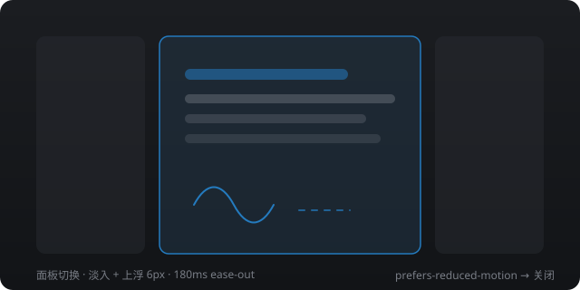

# 页面过渡动画

克制的进入动画，只在**内容真的换了**的时候播，不做循环动效、不做常驻装饰。

## 动了哪些地方

| 场景 | 效果 | 时长 |
| --- | --- | --- |
| 主面板切换（会话 ↔ 插件 ↔ 设置…） | 淡入 + 上浮 6px | 180ms |
| 右侧栏换 tab | 淡入 + 上浮 6px | 180ms |
| 弹窗 / 设置面板 / 平台页出现 | 淡入 + 放大 0.985 → 1 | 220ms |

补充说明：

- 都用 ease-out，位移只有 6px，目的是让「换了一屏」这件事被眼睛接住，不是表演。
- 左侧导航抽屉本来就带自己的轨道动画，这里**排除**掉，避免两套动画打架。
- 同一面板内换会话**不会**触发动画（面板根节点没重挂），所以不会每切一次会话就闪一下。
- 系统开了「减少动态效果」（`prefers-reduced-motion: reduce`）时整套关闭，不是调慢。

## 为什么不会顶掉布局

动画只驱动 `translate` / `scale` 这两个独立变换属性，不碰 `transform`。
弹窗靠 `transform` 居中、靠 `transform` 做拖拽定位，都不受影响。
另外用了 `animation-fill-mode: backwards`，动画结束后不保留任何属性，
之后被宿主用 class 隐藏的元素不会被动画的空状态钉住。

## 想自己调

在自己的用户样式里覆盖这几个变量即可（`:where()` 零优先级，随便什么选择器都能盖掉）：

```css
:root {
  --dsh-motion-duration: 180ms;       /* 面板 / tab */
  --dsh-motion-duration-slow: 220ms;  /* 弹窗 */
  --dsh-motion-ease: cubic-bezier(0.22, 0.61, 0.36, 1);
  --dsh-motion-shift: 6px;            /* 上浮距离 */
}
```

想临时全关，把 `--dsh-motion-shift` 设成 `0px` 并把两个 duration 设成 `1ms` 最省事。

## 稳定性

选择器只依赖宿主已经公开的结构特征：`_mainPanel` 类名后缀（CSS Module 编译产物，
前缀哈希会变但后缀稳定）、`data-sidebar-right-tab`、`data-dockkit-pane`、
`role="dialog"` + `aria-modal="true"`。
哪一天宿主改名了，表现是「这块动画消失」，页面照常工作，不会白屏也不会报错。
